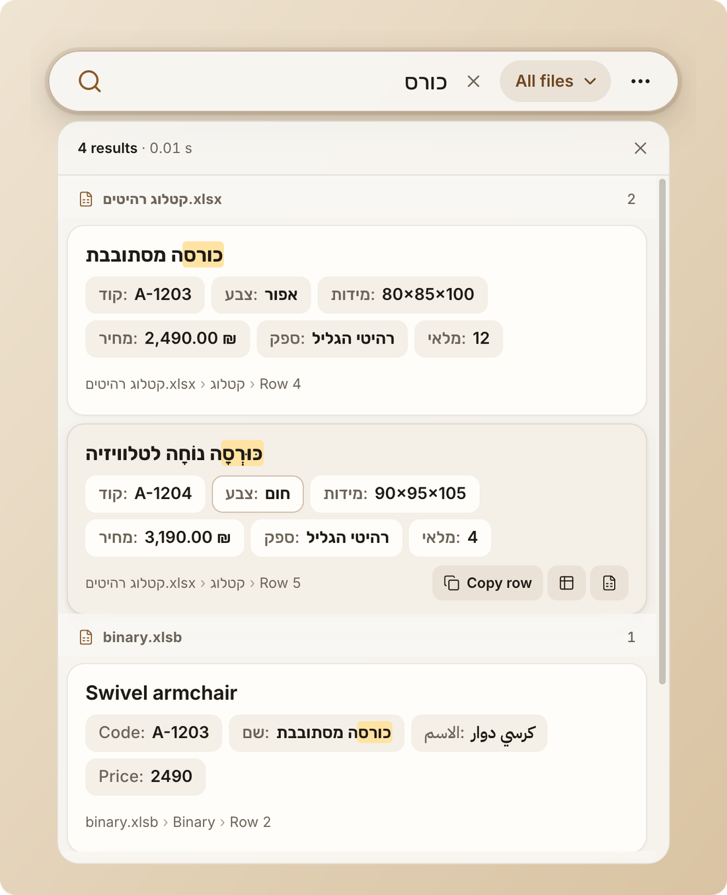
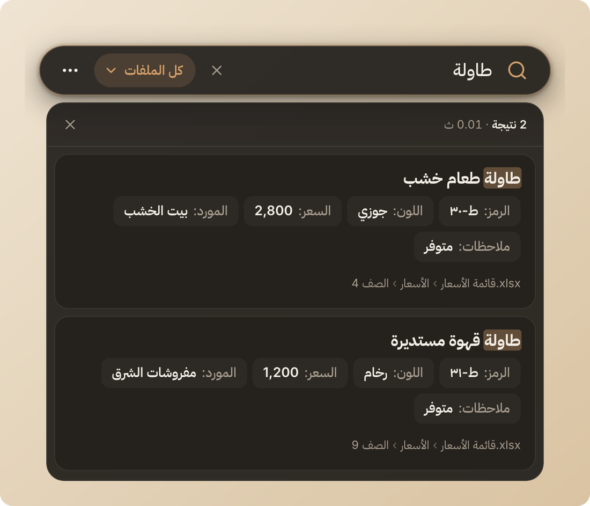
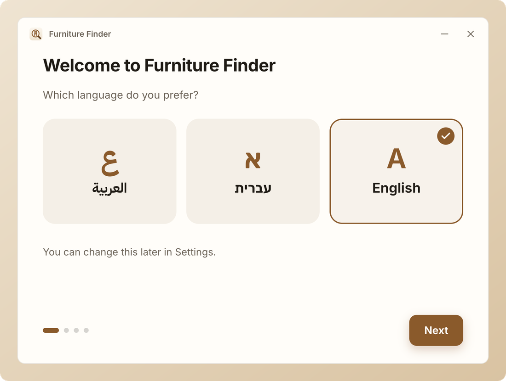
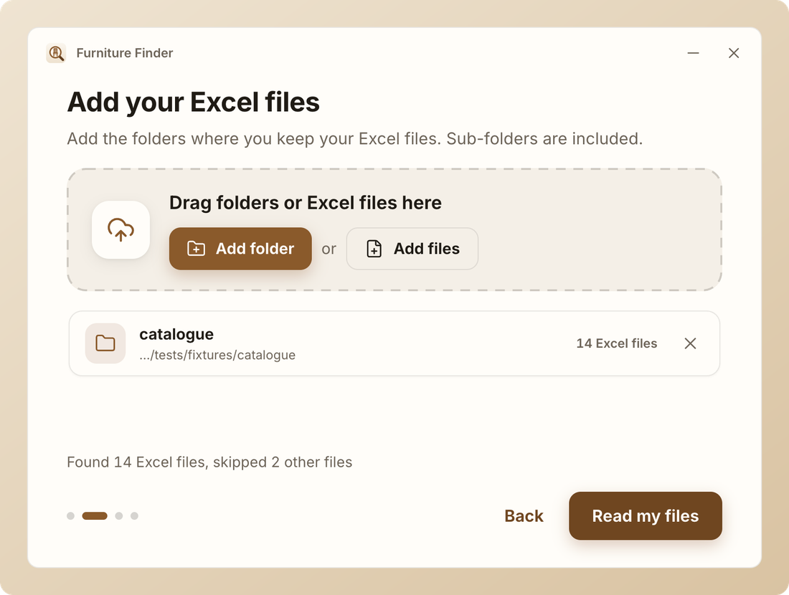
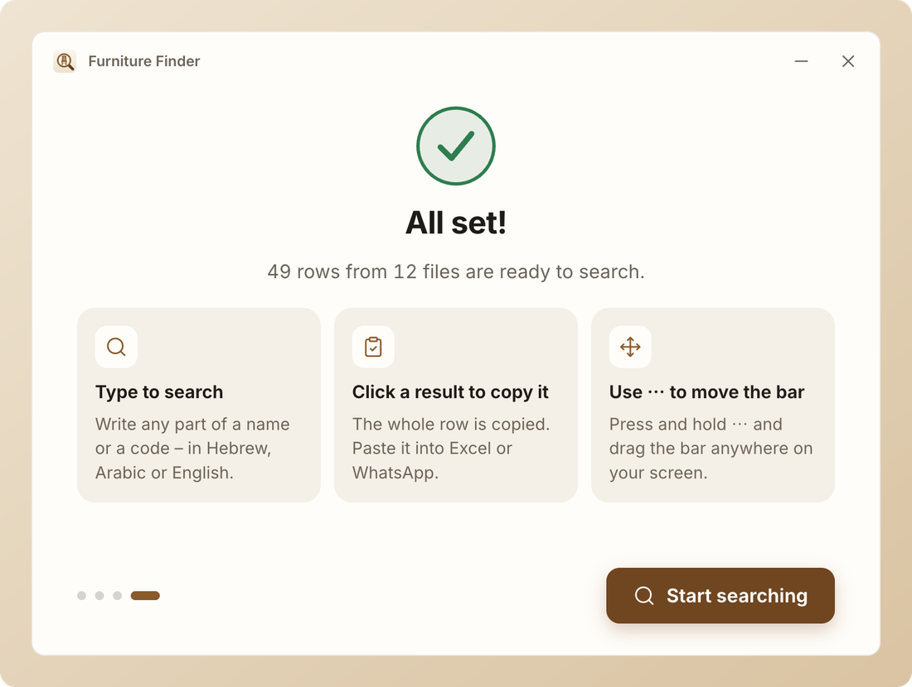
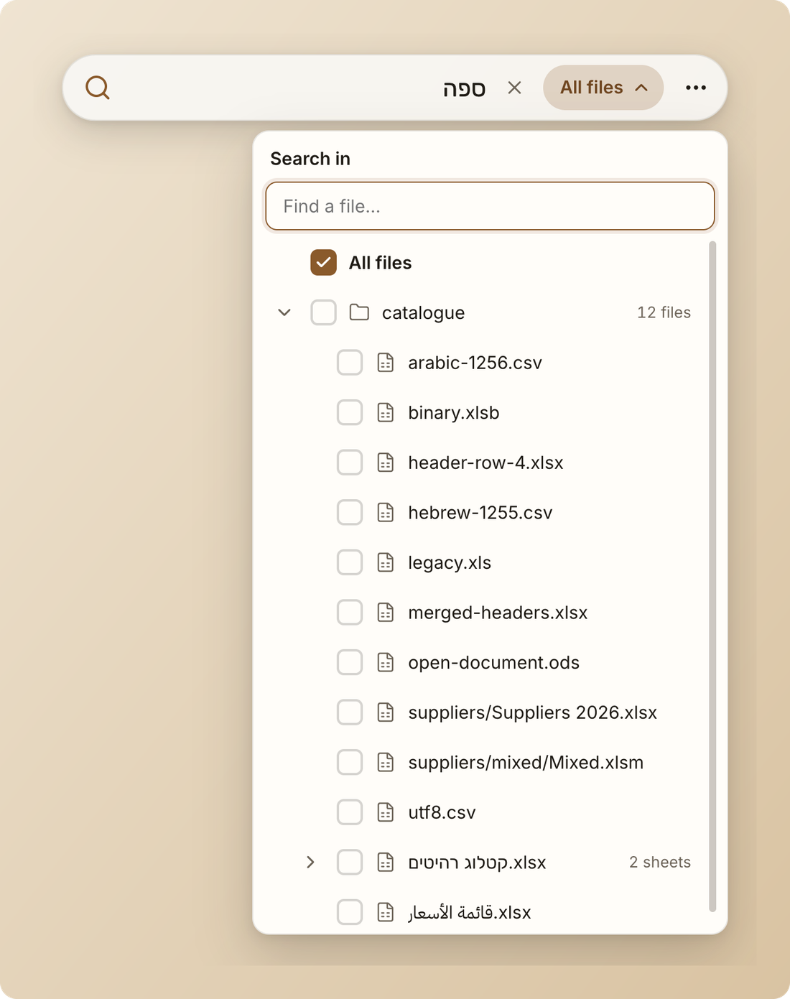
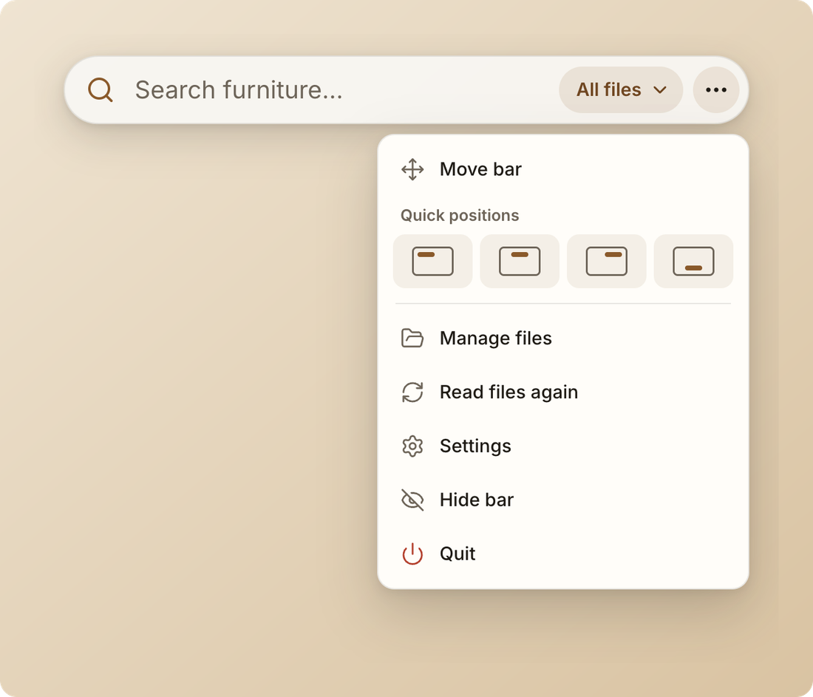
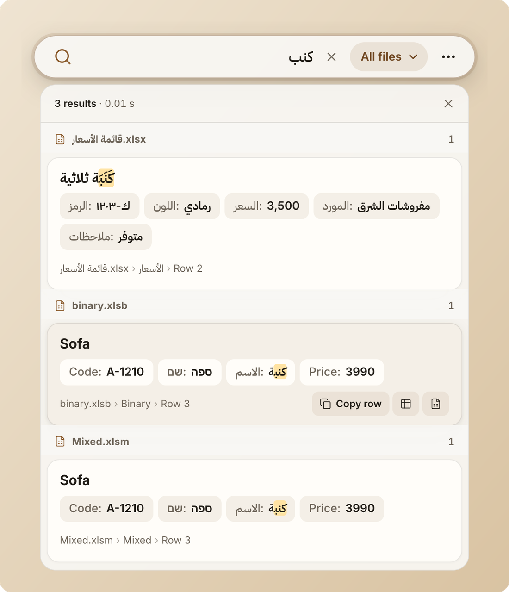

<p align="center">
  
</p>

<h1 align="center">Furniture Finder</h1>

<p align="center">
  A search bar that floats over every window and finds any product in all your Excel files —<br />
  in <b>Hebrew</b>, <b>Arabic</b> and <b>English</b>. Click a result to copy it.
</p>

<p align="center">
  <a href="https://github.com/saad-aghbar/furniture-finder/releases/latest"><b>⬇ Download for Windows</b></a>
  &nbsp;·&nbsp; <a href="#english">English</a> &nbsp;·&nbsp; <a href="#arabic">العربية</a> &nbsp;·&nbsp; <a href="#hebrew">עברית</a>
</p>

<p align="center">
  
  &nbsp;
  
</p>

- Searches **every row of every sheet** of every Excel file in the folders you choose (`.xlsx .xlsm .xlsb .xls .csv .ods`).
- Ignores niqqud and tashkeel, treats Arabic letter variants and Hebrew final letters as the same, finds parts of words, forgives typing mistakes, matches codes like `A-12` → `A-1203`.
- **Click a card → the whole row is copied.** Paste into Excel and you get cells; paste into WhatsApp and you get readable lines.
- Always on top — even over full-screen Excel. Never in the taskbar or Alt-Tab.
- 100 % offline and private: your files never leave the computer. The app only checks GitHub for updates.

---

<a id="english"></a>

## 🇬🇧 English

### Download & install

1. Open **<https://github.com/saad-aghbar/furniture-finder/releases/latest>**.
2. Under **Assets**, click **`Furniture-Finder-Setup-1.0.0.exe`** (the newest version number may be higher).
3. Open the downloaded file. Windows may show a blue box **“Windows protected your PC”**.
   This happens with new programs that are not yet well known. Click **More info**, then **Run anyway**.
4. Choose where to install (the suggested place is fine) and click **Install**. No administrator password is needed.
5. Furniture Finder opens by itself at the end.

### First start

1. **Choose your language** – العربية, עברית or English.
2. **Add your files** – drag your Excel folders onto the window, or click **Add folder** / **Add files**.
   Sub-folders are included. Other kinds of files are skipped.
3. **Wait a moment** while the files are read (only the first time). You can click **Start searching now** to begin straight away.
4. The **search bar** appears at the top of the screen.

<p align="center">
  
  
  
</p>

### How to use

| To… | Do this |
|---|---|
| Search | Click the bar and type part of a name, a code, a colour, a supplier… in any language. |
| Copy a whole row | Click the result card. A green **Copied ✓** appears. Paste with **Ctrl+V**. |
| Copy one value | Click a single detail (for example *Price: 2,490*). |
| Open the file | Hover a result and click the **Excel** button – Excel opens at that row. |
| Search only some files | Click the **All files** button on the bar and tick folders, files or sheets. |
| Move the bar | **Press and hold ⋯** and drag, or drag the magnifier icon, or ⋯ → **Move bar**. Quick positions are in the ⋯ menu. |
| Make it wider | Drag the left or right end of the bar. |
| Use the keyboard | **Ctrl+Shift+Space** jumps to the bar from anywhere. **↓ / ↑** choose a result, **Enter** copies it, **Ctrl+Enter** opens it in Excel, **Esc** clears. |
| Add or remove folders | ⋯ → **Manage files**. |
| Change language, colours, text size | ⋯ → **Settings**. |

<p align="center">
  
  &nbsp;
  
</p>

### Questions

**The bar disappeared.** Press **Ctrl+Shift+Space**, or click the Furniture Finder icon near the clock (you may need to click the small ^ arrow first).

**A file is not found.** Open ⋯ → **Manage files**. Files that could not be read are listed there with the reason – for example a password-protected file. Remove the password in Excel and it will be read automatically. Also check the file is inside one of the added folders.

**I changed a file – do I need to do anything?** No. Changes, new files, renamed and deleted files are picked up by themselves within a few seconds. It also works while the file is open in Excel.

**Does my data go online?** No. Everything is searched on this computer, also without internet. Your Excel files are only read, never changed. The only internet access is a quiet check for new versions on GitHub.

**How do I update?** Updates download by themselves. When one is ready, a green **Update ready – restart** button appears on the bar.

**How do I uninstall?** Windows Settings → Apps → Furniture Finder → Uninstall.

---

<a id="arabic"></a>

<div dir="rtl" lang="ar">

## 🇸🇦 العربية

### التنزيل والتثبيت

1. افتح **<https://github.com/saad-aghbar/furniture-finder/releases/latest>**.
2. في قسم **Assets** انقر على الملف **`Furniture-Finder-Setup-1.0.0.exe`** (قد يكون رقم الإصدار أحدث).
3. افتح الملف الذي تم تنزيله. قد يُظهر ويندوز نافذة زرقاء بعنوان **«Windows protected your PC»**.
   هذا يحدث مع البرامج الجديدة غير المعروفة بعد. انقر على **More info** (مزيد من المعلومات) ثم على **Run anyway** (تشغيل على أي حال).
4. اختر مكان التثبيت (المكان المقترح مناسب) وانقر **Install**. لا حاجة إلى كلمة مرور المسؤول.
5. يفتح باحث الأثاث تلقائياً في النهاية.

### التشغيل الأول

1. **اختر لغتك** – العربية أو العبرية أو الإنجليزية.
2. **أضف ملفاتك** – اسحب مجلدات الإكسل إلى النافذة، أو انقر **إضافة مجلد** / **إضافة ملفات**. المجلدات الفرعية مشمولة، والملفات الأخرى يتم تجاوزها.
3. **انتظر قليلاً** حتى تُقرأ الملفات (في المرة الأولى فقط). يمكنك النقر على **ابدأ البحث الآن** للبدء فوراً.
4. يظهر **شريط البحث** في أعلى الشاشة.

### طريقة الاستخدام

| لكي… | افعل هذا |
|---|---|
| تبحث | انقر على الشريط واكتب جزءاً من الاسم أو الرمز أو اللون أو المورّد… بأي لغة. |
| تنسخ صفاً كاملاً | انقر على بطاقة النتيجة. تظهر علامة خضراء **تم النسخ ✓**. الصق بـ **Ctrl+V**. |
| تنسخ قيمة واحدة | انقر على تفصيل واحد (مثلاً *السعر: 3,500*). |
| تفتح الملف | مرّر الفأرة فوق النتيجة وانقر زر **إكسل** – يفتح إكسل على هذا الصف. |
| تبحث في بعض الملفات فقط | انقر زر **كل الملفات** على الشريط واختر مجلدات أو ملفات أو أوراقاً. |
| تحرّك الشريط | **اضغط مطولاً على ⋯** واسحب، أو اسحب أيقونة العدسة، أو ⋯ ← **تحريك الشريط**. المواضع السريعة في قائمة ⋯. |
| تجعله أعرض | اسحب الطرف الأيمن أو الأيسر للشريط. |
| تستخدم لوحة المفاتيح | **Ctrl+Shift+Space** ينقلك إلى الشريط من أي مكان. **↓ / ↑** لاختيار نتيجة، **Enter** للنسخ، **Ctrl+Enter** للفتح في إكسل، **Esc** للمسح. |
| تضيف مجلدات أو تزيلها | ⋯ ← **إدارة الملفات**. |
| تغيّر اللغة أو الألوان أو حجم النص | ⋯ ← **الإعدادات**. |

<p align="center"></p>

### أسئلة شائعة

**اختفى الشريط.** اضغط **Ctrl+Shift+Space**، أو انقر أيقونة باحث الأثاث بجانب الساعة (قد تحتاج إلى النقر على السهم الصغير ^ أولاً).

**ملف لا يظهر في النتائج.** افتح ⋯ ← **إدارة الملفات**. الملفات التي تعذّرت قراءتها مذكورة هناك مع السبب – مثلاً ملف محمي بكلمة مرور. أزل كلمة المرور في إكسل وسيُقرأ تلقائياً. وتأكد أن الملف داخل أحد المجلدات المضافة.

**غيّرت ملفاً – هل عليّ فعل شيء؟** لا. التغييرات والملفات الجديدة والمحذوفة تُلتقط وحدها خلال ثوانٍ، حتى لو كان الملف مفتوحاً في إكسل.

**هل تذهب بياناتي إلى الإنترنت؟** لا. البحث يتم على هذا الحاسوب فقط، ويعمل دون إنترنت. ملفات الإكسل تُقرأ فقط ولا تُعدَّل أبداً. الاتصال الوحيد هو فحص هادئ للتحديثات على GitHub.

**كيف أحدّث البرنامج؟** التحديثات تُنزَّل تلقائياً. عندما يكون التحديث جاهزاً يظهر زر أخضر **التحديث جاهز – أعد التشغيل** على الشريط.

</div>

---

<a id="hebrew"></a>

<div dir="rtl" lang="he">

## 🇮🇱 עברית

### הורדה והתקנה

1. פתחו את **<https://github.com/saad-aghbar/furniture-finder/releases/latest>**.
2. תחת **Assets** לחצו על הקובץ **`Furniture-Finder-Setup-1.0.0.exe`** (מספר הגרסה עשוי להיות חדש יותר).
3. פתחו את הקובץ שהורד. ייתכן ש־Windows יציג חלון כחול **„Windows protected your PC”**.
   זה קורה עם תוכנות חדשות שעוד לא מוכרות. לחצו על **More info** (מידע נוסף) ואז על **Run anyway** (הפעל בכל זאת).
4. בחרו היכן להתקין (המקום המוצע מתאים) ולחצו **Install**. אין צורך בסיסמת מנהל.
5. מאתר הרהיטים נפתח לבד בסוף ההתקנה.

### הפעלה ראשונה

1. **בחרו שפה** – ערבית, עברית או אנגלית.
2. **הוסיפו את הקבצים** – גררו את תיקיות האקסל לחלון, או לחצו **הוספת תיקייה** / **הוספת קבצים**. תיקיות משנה נכללות, וקבצים מסוג אחר מדולגים.
3. **המתינו רגע** עד שהקבצים נקראים (רק בפעם הראשונה). אפשר ללחוץ **להתחיל לחפש עכשיו** כדי להתחיל מיד.
4. **סרגל החיפוש** מופיע בראש המסך.

### איך משתמשים

| כדי… | עושים כך |
|---|---|
| לחפש | לוחצים על הסרגל ומקלידים חלק משם, קוד, צבע, ספק… בכל שפה. |
| להעתיק שורה שלמה | לוחצים על כרטיס התוצאה. מופיע סימון ירוק **הועתק ✓**. מדביקים עם **Ctrl+V**. |
| להעתיק ערך אחד | לוחצים על פרט אחד (למשל *מחיר: 2,490*). |
| לפתוח את הקובץ | מעבירים את העכבר מעל התוצאה ולוחצים על כפתור **אקסל** – אקסל נפתח בשורה הזו. |
| לחפש רק בחלק מהקבצים | לוחצים על **כל הקבצים** בסרגל ומסמנים תיקיות, קבצים או גיליונות. |
| להזיז את הסרגל | **לחיצה ארוכה על ⋯** וגרירה, או גרירת סמל הזכוכית המגדלת, או ⋯ ← **הזזת הסרגל**. מיקומים מהירים נמצאים בתפריט ⋯. |
| להרחיב אותו | גוררים את הקצה הימני או השמאלי של הסרגל. |
| להשתמש במקלדת | **Ctrl+Shift+Space** קופץ לסרגל מכל מקום. **↓ / ↑** לבחירת תוצאה, **Enter** להעתקה, **Ctrl+Enter** לפתיחה באקסל, **Esc** לניקוי. |
| להוסיף או להסיר תיקיות | ⋯ ← **ניהול קבצים**. |
| לשנות שפה, צבעים, גודל טקסט | ⋯ ← **הגדרות**. |

### שאלות נפוצות

**הסרגל נעלם.** לחצו **Ctrl+Shift+Space**, או לחצו על הסמל של מאתר הרהיטים ליד השעון (ייתכן שצריך ללחוץ קודם על החץ הקטן ^).

**קובץ לא נמצא.** פתחו ⋯ ← **ניהול קבצים**. קבצים שלא נקראו מופיעים שם עם הסיבה – למשל קובץ עם סיסמה. הסירו את הסיסמה באקסל והוא ייקרא אוטומטית. בדקו גם שהקובץ נמצא באחת התיקיות שנוספו.

**שיניתי קובץ – צריך לעשות משהו?** לא. שינויים, קבצים חדשים, ששמם שונה או שנמחקו נקלטים לבד תוך שניות, גם כשהקובץ פתוח באקסל.

**האם המידע שלי עולה לאינטרנט?** לא. החיפוש מתבצע רק במחשב הזה, וגם בלי אינטרנט. קובצי האקסל רק נקראים ולעולם לא משתנים. החיבור היחיד הוא בדיקה שקטה לעדכונים ב־GitHub.

**איך מעדכנים?** עדכונים יורדים לבד. כשעדכון מוכן מופיע על הסרגל כפתור ירוק **עדכון מוכן – הפעלה מחדש**.

</div>

---

## For the developer

Electron 44 · React 19 · TypeScript · electron-vite · Motion · SheetJS · better-sqlite3 (FTS5 trigram) · chokidar · electron-builder (NSIS) · electron-updater · Vitest · Playwright.
Specs live in [`docs/`](docs) — product ([SPEC](docs/SPEC.md)), architecture ([ARCHITECTURE](docs/ARCHITECTURE.md)),
design & motion ([DESIGN](docs/DESIGN.md)), release ([BUILD_AND_RELEASE](docs/BUILD_AND_RELEASE.md)) and every
deviation in [DECISIONS](docs/DECISIONS.md).

```bash
npm install          # also compiles better-sqlite3 for Electron
npm run dev          # run on macOS / Windows with hot reload
npm run test         # unit tests (run on Electron's Node so the native module matches)
npm run test:e2e     # builds, then Playwright-Electron flows: onboarding → search → scope → copy → move
npm run test:perf    # 500k-row search benchmark (< 50 ms per query)
npm run lint         # eslint + typecheck
npm run fixtures     # regenerate the he/ar/en sample workbooks in tests/fixtures
npm run icons        # regenerate the app/tray icons from SVG
```

**Releasing.** The Windows installer is built only by GitHub Actions on `windows-latest`
([`release.yml`](.github/workflows/release.yml)): lint, unit tests, package, Playwright smoke test of the packaged
app, then the NSIS installer, `.blockmap` and `latest.yml` are published to the GitHub Release.

```bash
npm version patch    # or minor – bumps package.json and creates the tag
git push --follow-tags
```

**Repository visibility.** The repo starts private. GitHub Release downloads and `electron-updater` without a
token only work for **public** repositories, so before sharing the download link either

1. make this repo public: `gh repo edit --visibility public --accept-visibility-change-consequences`, or
2. keep the code private and publish releases to a second, public repo: create `furniture-finder-releases`,
   set `publish.repo` in [`electron-builder.yml`](electron-builder.yml) to it, add a fine-grained PAT with
   *Contents: write* on that repo as the secret `RELEASES_TOKEN`, and use `GH_TOKEN: ${{ secrets.RELEASES_TOKEN }}`
   in the release workflow.

**Code signing** is not set up (installers are unsigned → SmartScreen warning). Stubs for Azure Trusted Signing /
a certificate are commented in `electron-builder.yml`.

**Data locations (Windows).** Index `%APPDATA%\Furniture Finder\index.db`, settings `settings.json`,
logs `%APPDATA%\Furniture Finder\logs\main.log`.
